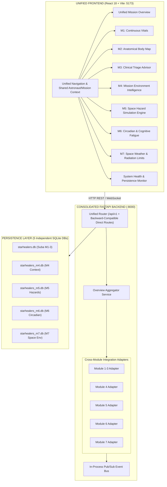

# STARHEALERS UNIFIED PLATFORM — ARCHITECTURE SPECIFICATION

## 1. Executive Architecture Summary

STARHEALERS is a unified astronaut health and deep-space mission monitoring platform that integrates seven specialized subsystems into a **Modular Monolith** architecture:
- **One Consolidated FastAPI Backend**: Operating on port `8000` with 148 registered endpoints.
- **One Unified React Frontend**: Built with Vite, React 18, TypeScript, TailwindCSS, and ECharts/Recharts on port `5173`.
- **Five Independent SQLite Persistence Layers**: Cleanly partitioned per domain with zero destructive schema migrations.

---

## 2. Modular Monolith Design & Namespace Isolation

To resolve namespace collisions where individual modules originally declared a top-level `app` package, the unified backend nests modules into explicit sub-packages:
- `app.modules.module123_suba`: Suba's core vital monitoring, anatomical body map, and rule triage.
- `app.modules.module4_mission_intelligence`: Mission profiles, environmental intelligence, and operational state machine.
- `app.modules.module5_hazard_simulation`: Physics-based radiation, cabin $\text{CO}_2$ ODE mass balance, and sleep deficit engines.
- `app.modules.module6_circadian_fatigue`: 3-process sleep regulation, circadian alertness modeling, and PVT test battery.
- `app.modules.module7_space_environment`: Space weather (SPE/GCR), NASA career radiation dose tracking, and ECLSS telemetry.

Each module manages its own models, schemas, and services, guaranteeing complete decoupling and avoiding cross-module namespace pollution.

---

## 3. Strict Non-Duplication Rule Compliance

Per project constraints, simulation engines and calculations are never duplicated:
- **Module 5 Authoritative Ownership**: Module 5 exclusively owns the physical simulation engines (`SpaceRadiationEngine`, `SpacecraftCO2Engine`, `AstronautSleepEngine`).
- **Module 4 Adaptation**: Module 4 receives simulated hazard data via API export (`POST /context/state` or `/simulations/{id}/export-to-module4`) and triggers operational state transitions without computing physics independently.
- **Module 6 & 7 Consumption**: Modules 6 and 7 query or adapt Module 5 outputs via cross-module adapters rather than reimplementing radiation shielding or sleep kinetics.

---

## 4. Shared Context & Session Management

The unified frontend features a global `SharedMissionContext` providing:
1. **Synchronized Active Astronaut**: Switching subject (e.g., `ASTRO-01 Sarah Connor` to `ASTRO-02 Mark Watney`) dynamically repopulates vitals (M1), organ stress (M2), triage alerts (M3), circadian alertness curves (M6), and career radiation doses (M7).
2. **Synchronized Mission Profile**: Selecting a mission profile (ISS Expedition, Artemis Lunar Basecamp, Ares V Mars Transit) automatically updates expected environmental envelopes across M4, M5, and M7.
3. **Single-Page View Routing**: Switching between subsystems occurs instantly in memory without browser page reload, maintaining WebSocket streams and form states.

---

## 5. Port Allocations & Backward Compatibility

| Subsystem | Port | Protocol | Path Prefix | Backward Compatibility |
| :--- | :--- | :--- | :--- | :--- |
| **Unified Backend** | `8000` | HTTP / WS | `/api/v1` | Supports direct routes: `/api/missions`, `/api/astronauts`, `/missions`, `/engines`, `/pvt`, `/alerts` |
| **Unified Frontend** | `5173` | HTTP | `/` | Single React SPA hosting all 7 modules |
